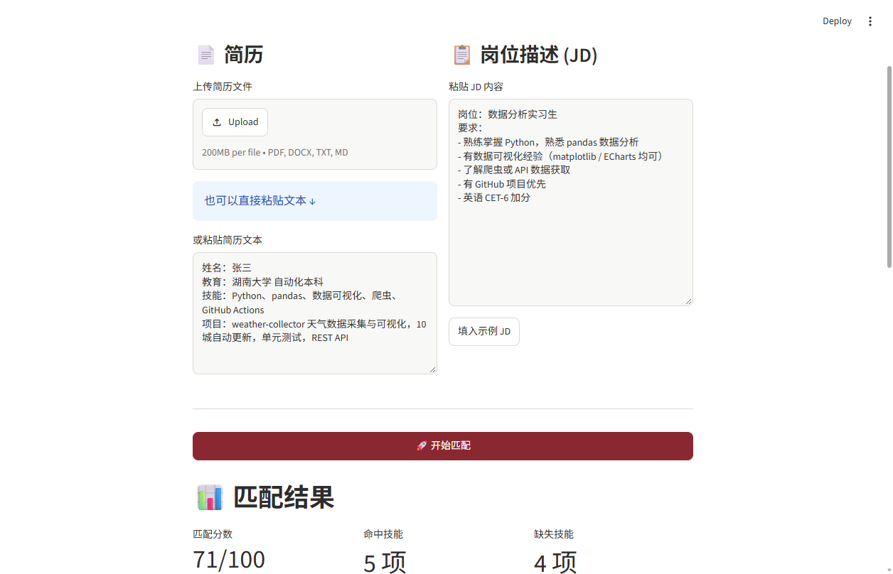

# 🎯 resume-matcher · 简历 vs JD 匹配分析器

> 上传简历 + 粘贴岗位描述 → 得到**可解释**的匹配报告：分数、命中/缺失技能、改进建议、扣分理由。


---

## 🤔 问题

海投简历石沉大海，最常见的困惑是：**我到底差在哪？**

大多数求职工具只给一个模糊的"匹配度百分比"，不给理由。你不知道是技能不够、项目不对口，还是表达方式有问题。

## 💡 方案

用 LLM 对简历和 JD 做**结构化比对**，输出一份可解释的匹配报告：

```
✅ 命中技能   ❌ 缺失技能   💡 改进建议   🔍 扣分/加分理由（带原文证据）
```

- **可解释**：每条结论都引用简历/JD 原文，不黑盒
- **双引擎**：LLM 打分（准）+ 规则引擎兜底（无 API 也能用，可离线测试）
- **隐私**：文件本地解析，不上传 PDF，只把文本发给 LLM（可换本地 Ollama）

## 🖼 效果



三张卡一眼看全：**匹配分数 / 命中技能 / 缺失技能**，下面逐条给改进建议和理由。

## 🚀 快速开始

```bash
pip install -r requirements.txt

# 规则引擎（无需 API Key，立即可玩）
streamlit run app.py

# LLM 打分（更准，可选）
export OPENAI_API_KEY="sk-..."
export OPENAI_BASE_URL="https://api.deepseek.com/v1"   # OpenAI 兼容即可
streamlit run app.py
```

## 🧱 项目结构

```
resume-matcher/
├── app.py              # Streamlit 界面
├── matcher/
│   ├── extract.py      # 解析 PDF / DOCX / TXT / MD → 文本
│   ├── scorer.py       # LLM 结构化打分 + 规则引擎兜底
│   └── __init__.py
├── tests/              # 8 个单元测试
└── requirements.txt
```

## 🧪 测试

```bash
python -m pytest tests/ -v
```

覆盖：文本提取（txt/md/docx/不支持格式）、规则打分（命中/全命中/零命中/分数越界清洗）。

## ⚠️ 限制（诚实声明）

- LLM 打分是**参考**，不是招聘结论——它看不到招聘方的真实偏好
- 规则引擎只做关键词匹配，适合快速 demo 和离线测试
- 简历里的**成果数字**（"性能提升 30%"）比技能列表更值钱，LLM 版本会重点看

## 🗺 路线图

- [x] v1 规则引擎 + Streamlit 界面
- [x] LLM 结构化打分（JSON schema）
- [ ] 在线部署 demo（Streamlit Cloud）
- [ ] 简历成果数字抽取与强调
- [ ] 多份简历对比模式

## 📮 联系

- QQ 邮箱：`264589301@qq.com`
- 欢迎 Star ⭐ 与 Issue 建议

---

*考研间隙做的小工具，写完发现自己也用得上。* 🌱